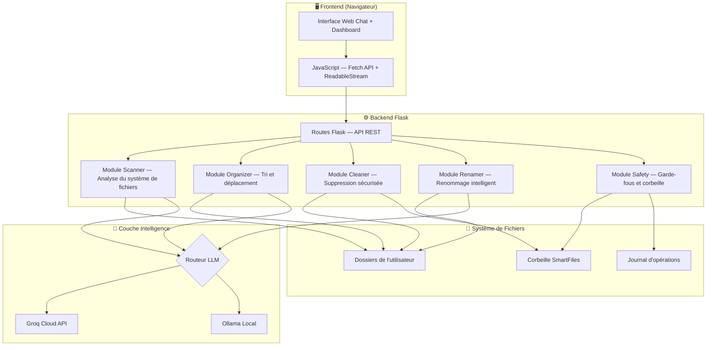

# 🗂️ SmartFiles — Assistant Intelligent de Gestion de Stockage

> **Projet de cours — Déploiement Développement Web (5IAD G1)**
> Auteur : Omar Tarrouzi
> Date : Octobre 2026

---

## 📋 Table des matières

1. [Présentation du projet](#1-présentation-du-projet)
2. [Problématique et contexte](#2-problématique-et-contexte)
3. [Fonctionnalités principales](#3-fonctionnalités-principales)
   - [Module 1 : Nettoyage ciblé (suppression sélective)](#module-1--nettoyage-ciblé-suppression-sélective)
   - [Module 2 : Tri et organisation automatique](#module-2--tri-et-organisation-automatique)
   - [Module 3 : Renommage intelligent de fichiers](#module-3--renommage-intelligent-de-fichiers)
   - [Module 4 : Assistant conversationnel IA](#module-4--assistant-conversationnel-ia)
4. [Architecture technique](#4-architecture-technique)
   - [Stack technologique](#stack-technologique)
   - [Architecture en couches](#architecture-en-couches)
   - [Choix du LLM : Groq Cloud vs. Ollama local](#choix-du-llm--groq-cloud-vs-ollama-local)
5. [Modèle de données et analyse de fichiers](#5-modèle-de-données-et-analyse-de-fichiers)
6. [Routes Flask (API Backend)](#6-routes-flask-api-backend)
7. [Interface utilisateur (Frontend)](#7-interface-utilisateur-frontend)
8. [Sécurité et garde-fous](#8-sécurité-et-garde-fous)
9. [Structure du projet](#9-structure-du-projet)
10. [Dépendances](#10-dépendances)
11. [Plan de réalisation par étapes](#11-plan-de-réalisation-par-étapes)
12. [Exemples de scénarios d'utilisation](#12-exemples-de-scénarios-dutilisation)
13. [Extensions futures possibles](#13-extensions-futures-possibles)

---

## 1. Présentation du projet

**SmartFiles** est une application web développée en **Python / Flask** et propulsée par un **LLM (Large Language Model)** dont le rôle est d'**aider les utilisateurs à nettoyer, trier et organiser intelligemment leurs fichiers** sur leur disque dur ou dans un répertoire spécifique.

L'application vise un public qui :
- Accumule des milliers de fichiers désorganisés (photos, présentations, documents, téléchargements…).
- Souhaite libérer de l'espace disque mais **ne sait pas par où commencer**.
- A **peur de supprimer accidentellement** des fichiers importants.
- Manque de temps ou de méthode pour trier manuellement.

Le LLM intervient comme un **assistant conversationnel** qui analyse, conseille et exécute (avec validation de l'utilisateur) les opérations de nettoyage et de classement.

---

## 2. Problématique et contexte

### Le problème

| Situation | Impact |
|-----------|--------|
| Des milliers de fichiers en vrac dans `Téléchargements/` | Impossible de retrouver un document précis |
| Des photos nommées `IMG_20241015_143022.jpg` ou `DSC00342.JPG` | Aucune signification humaine lisible |
| Des doublons (fichiers identiques copiés à plusieurs endroits) | Gaspillage d'espace disque |
| Des fichiers `.tmp`, `.log`, `.bak` oubliés | Accumulation silencieuse de Go inutiles |
| Des présentations PowerPoint de 2018 mélangées avec celles de 2026 | Aucune organisation chronologique ou thématique |

### La solution SmartFiles

L'application offre une approche **progressive et sécurisée** en 3 niveaux :

```
Niveau 1 : ANALYSER     → Scanner un dossier, extraire les métadonnées, présenter un bilan clair
Niveau 2 : RECOMMANDER  → Le LLM propose un plan de nettoyage / tri adapté au contenu trouvé
Niveau 3 : EXÉCUTER     → Effectuer les opérations (suppression, déplacement, renommage)
                           UNIQUEMENT après validation explicite de l'utilisateur
```

---

## 3. Fonctionnalités principales

### Module 1 : Nettoyage ciblé (suppression sélective)

Permet à l'utilisateur de supprimer des fichiers selon des **critères précis** :

| Critère | Description | Exemple |
|---------|-------------|---------|
| **Date** | Fichiers antérieurs / postérieurs à une date | « Supprimer tout ce qui date d'avant 2020 » |
| **Format / Extension** | Filtrage par type de fichier | « Supprimer tous les `.tmp` et `.log` » |
| **Taille** | Fichiers dépassant ou inférieurs à un seuil | « Lister les fichiers de plus de 500 Mo » |
| **Doublons** | Détection par hash MD5/SHA256 | « Trouver et supprimer les fichiers en double » |
| **Ancienneté d'accès** | Fichiers non ouverts depuis X mois | « Quels fichiers n'ont pas été ouverts depuis 1 an ? » |

#### Fonctionnement :
1. L'utilisateur sélectionne un dossier à analyser via l'interface web.
2. Le backend scanne le dossier et collecte les métadonnées de chaque fichier.
3. L'utilisateur applique des filtres (date, taille, extension…) ou **demande au LLM** ce qu'il conseille de supprimer.
4. L'application affiche les fichiers concernés avec un **résumé clair** (nombre de fichiers, espace récupérable).
5. L'utilisateur valide ou ajuste la sélection avant toute suppression.

> [!IMPORTANT]
> **Aucun fichier n'est jamais supprimé sans validation explicite de l'utilisateur.**
> Les fichiers sont d'abord déplacés vers une corbeille temporaire de l'application (dossier `.smartfiles_trash/`) avant suppression définitive, offrant une possibilité de récupération.

---

### Module 2 : Tri et organisation automatique

Le LLM analyse le contenu du dossier et propose une **arborescence de classement intelligente** :

#### Stratégies de tri disponibles :

**a) Tri par type de fichier :**
```
📁 Documents/
├── 📁 PowerPoint/
├── 📁 PDF/
├── 📁 Word/
└── 📁 Excel/
📁 Images/
├── 📁 JPEG/
├── 📁 PNG/
└── 📁 RAW/
📁 Vidéos/
📁 Archives/
```

**b) Tri chronologique (par année / mois) :**
```
📁 2024/
├── 📁 Janvier/
├── 📁 Février/
└── …
📁 2025/
├── 📁 Mars/
└── …
📁 2026/
```

**c) Tri hybride (combiné — recommandé par le LLM en fonction du contexte) :**
```
📁 Présentations/
├── 📁 2024/
│   ├── cours_maths_chapitre3.pptx
│   └── soutenance_projet_IA.pptx
├── 📁 2025/
└── 📁 2026/
📁 Photos/
├── 📁 2025-Vacances-Marrakech/
├── 📁 2026-Soirée-Anniversaire/
└── 📁 Non-classées/
```

#### Rôle du LLM dans le tri :
- Le LLM reçoit un **résumé statistique** du dossier (répartition par types, dates, tailles).
- Il propose la stratégie de tri la **plus adaptée** au contenu détecté.
- L'utilisateur peut modifier la proposition via le chat avant exécution.

---

### Module 3 : Renommage intelligent de fichiers

Le renommage intelligent s'applique particulièrement aux fichiers dont le nom actuel n'est pas descriptif (noms générés automatiquement par appareils photo, captures d'écran, etc.).

#### Méthodes de renommage :

| Source d'information | Exemple d'entrée | Exemple de sortie |
|---------------------|-------------------|-------------------|
| **Métadonnées EXIF** (photos) | `IMG_20250615_183042.jpg` | `2025-06-15_Coucher-de-soleil.jpg` |
| **Analyse du contenu par le LLM** (vision) | `DSC00342.JPG` | `Chat-noir-sur-canapé.jpg` |
| **Date de modification** | `Nouveau document (3).docx` | `2026-03-12_Document-sans-titre.docx` |
| **Contenu textuel** (PDF, DOCX) | `scan001.pdf` | `Facture-EDF-Janvier-2025.pdf` |

#### Flux de renommage :
```
Fichier détecté → Extraction métadonnées → Envoi au LLM pour proposition de nom
    → Affichage du renommage proposé à l'utilisateur → Validation → Exécution
```

> [!NOTE]
> Pour l'analyse du contenu des photos, le LLM doit supporter la **vision** (modèle multimodal). Si le mode local (Ollama) est choisi avec un modèle uniquement textuel, le renommage des images se basera uniquement sur les métadonnées EXIF et la date.

---

### Module 4 : Assistant conversationnel IA

L'interface de chat (inspirée du TP2 FlaskGPT) permet à l'utilisateur de communiquer naturellement avec l'assistant :

#### Exemples de requêtes prises en charge :

```
💬 « Analyse mon dossier Téléchargements et dis-moi ce qui prend le plus de place »
💬 « Supprime tous les fichiers .log et .tmp de plus de 6 mois »
💬 « Trie mes présentations PowerPoint par année »
💬 « Renomme mes photos du dossier Vacances avec des noms descriptifs »
💬 « Quels sont les doublons dans mes Documents ? »
💬 « Je veux libérer 5 Go, que me proposes-tu de supprimer en priorité ? »
💬 « Annuler la dernière opération »
```

#### Cycle de conversation :
```
Utilisateur : "Trie mes fichiers du dossier Bureau"
      ↓
LLM : "J'ai analysé votre dossier Bureau. Il contient :
       • 342 fichiers (1.8 Go total)
       • 156 images, 89 documents, 45 présentations, 52 autres

       Je propose le tri suivant :
       📁 Images/ (par année puis par mois)
       📁 Documents/ (par type : PDF, Word, Excel)
       📁 Présentations/ (par année)
       📁 Autres/

       Voulez-vous que je procède ? Vous pouvez aussi modifier cette organisation."
      ↓
Utilisateur : "Oui, mais mets les présentations et les documents ensemble"
      ↓
LLM : "Compris ! Nouvelle organisation proposée :
       📁 Images/ (par année puis par mois)
       📁 Travail/ (Documents + Présentations, triés par année)
       📁 Autres/

       ✅ Confirmer  |  ✏️ Modifier  |  ❌ Annuler"
```

---

## 4. Architecture technique

### Stack technologique

| Couche | Technologie | Justification |
|--------|-------------|---------------|
| **Backend** | Python 3.14 + Flask 3.x | Cohérence avec le cours (TP2 Flask) ; léger et adapté aux API REST |
| **LLM Cloud** | Groq API (via SDK `openai`) | Réponses ultra-rapides grâce aux puces LPU ; API compatible OpenAI |
| **LLM Local** | Ollama (Llama 3, Mistral) | Alternative 100% locale pour les utilisateurs soucieux de leur vie privée |
| **Frontend** | HTML5 + Tailwind CSS + JavaScript vanilla | Cohérence avec le TP2 ; interface responsive et moderne |
| **Streaming** | Chunked Transfer Encoding + ReadableStream | Affichage progressif des réponses du LLM (comme dans le TP2) |
| **Analyse de fichiers** | `os`, `pathlib`, `hashlib`, `Pillow` (EXIF) | Bibliothèques standards et éprouvées pour la manipulation de fichiers |
| **Gestion de projet** | `uv` + `pyproject.toml` | Gestionnaire de paquets rapide, déjà utilisé dans le TP2 |

---

### Architecture en couches



---

### Choix du LLM : Groq Cloud vs. Ollama local

L'utilisateur peut choisir le moteur LLM depuis les **paramètres** de l'application :

| Critère | Groq Cloud | Ollama Local |
|---------|------------|--------------|
| **Vitesse** | ⚡ Très rapide (puces LPU) | 🐢 Dépend du matériel (CPU/GPU local) |
| **Confidentialité** | ⚠️ Données envoyées au cloud | ✅ 100% local, aucune donnée ne quitte la machine |
| **Modèles disponibles** | `openai/gpt-oss-20b`, `openai/gpt-oss-120b` | `llama3.2`, `mistral`, `llava` (vision) |
| **Coût** | Gratuit (limites de débit) | Gratuit, mais consomme des ressources locales |
| **Vision (analyse d'images)** | ✅ Selon le modèle | ✅ Avec `llava` ou modèle multimodal |
| **Nécessite Internet** | ✅ Oui | ❌ Non |
| **Configuration** | Clé API dans `.env` | Ollama installé + modèle téléchargé |

#### Implémentation du routeur LLM :
```python
# Le client est configuré dynamiquement selon le choix de l'utilisateur
if mode == "groq":
    client = OpenAI(api_key=os.getenv("GROQ_API_KEY"), base_url="https://api.groq.com/openai/v1")
    model = "openai/gpt-oss-20b"

elif mode == "ollama":
    client = OpenAI(
        api_key="ollama",  # Ollama n'exige pas de vraie clé
        base_url="http://localhost:11434/v1",
    )
    model = "llama3.2"
```

> [!TIP]
> Le SDK `openai` est utilisé dans les deux cas car **Ollama expose une API compatible OpenAI** sur `localhost:11434/v1`. Cela permet d'avoir un seul code client pour les deux modes, conformément à l'approche du TP2.

---

## 5. Modèle de données et analyse de fichiers

### Métadonnées extraites par le scanner

Pour chaque fichier analysé, le backend collecte les informations suivantes :

```python
@dataclass
class FileInfo:
    path: str  # Chemin absolu du fichier
    name: str  # Nom du fichier (avec extension)
    extension: str  # Extension seule (ex: ".pdf", ".jpg")
    size_bytes: int  # Taille en octets
    size_human: str  # Taille lisible (ex: "4.2 Mo")
    created_at: datetime  # Date de création
    modified_at: datetime  # Date de dernière modification
    accessed_at: datetime  # Date de dernier accès
    category: str  # Catégorie déduite (image, document, vidéo, archive, autre)
    hash_md5: str | None  # Empreinte MD5 (pour détection de doublons)
    exif_data: dict | None  # Métadonnées EXIF (pour les images)
    is_duplicate: bool  # Marqueur de doublon
    duplicate_of: str | None  # Chemin de l'original si doublon
```

### Catégorisation automatique par extension

```python
CATEGORIES = {
    "image": [".jpg", ".jpeg", ".png", ".gif", ".bmp", ".webp", ".svg", ".raw", ".heic"],
    "document": [".pdf", ".doc", ".docx", ".odt", ".txt", ".rtf", ".md"],
    "presentation": [".ppt", ".pptx", ".odp", ".key"],
    "tableur": [".xls", ".xlsx", ".csv", ".ods"],
    "video": [".mp4", ".avi", ".mkv", ".mov", ".wmv", ".flv", ".webm"],
    "audio": [".mp3", ".wav", ".flac", ".aac", ".ogg", ".wma"],
    "archive": [".zip", ".rar", ".7z", ".tar", ".gz", ".bz2"],
    "code": [".py", ".js", ".html", ".css", ".java", ".cpp", ".c", ".ts"],
    "temporaire": [".tmp", ".log", ".bak", ".swp", ".cache", ".thumbs"],
}
```

### Rapport d'analyse (envoyé au LLM pour recommandation)

```python
scan_report = {
    "total_files": 1842,
    "total_size": "12.4 Go",
    "categories": {
        "image": {"count": 856, "size": "5.2 Go"},
        "document": {"count": 234, "size": "1.1 Go"},
        "presentation": {"count": 178, "size": "2.8 Go"},
        "video": {"count": 23, "size": "2.1 Go"},
        "temporaire": {"count": 312, "size": "890 Mo"},
        "autre": {"count": 239, "size": "310 Mo"},
    },
    "duplicates": {"count": 67, "wasted_size": "1.3 Go"},
    "oldest_file": "2017-03-12",
    "newest_file": "2026-10-26",
    "not_accessed_1year": {"count": 423, "size": "3.7 Go"},
}
```

---

## 6. Routes Flask (API Backend)

### Routes de l'application

| Méthode | Route | Description |
|---------|-------|-------------|
| `GET` | `/` | Page d'accueil — Interface principale avec le chat et le dashboard |
| `POST` | `/scan` | Scanner un dossier et retourner le rapport d'analyse |
| `POST` | `/prompt` | Envoyer un message au LLM et recevoir la réponse en streaming |
| `POST` | `/clean` | Supprimer les fichiers sélectionnés (après validation utilisateur) |
| `POST` | `/organize` | Exécuter le plan de tri proposé par le LLM |
| `POST` | `/rename` | Renommer les fichiers selon les propositions du LLM |
| `POST` | `/undo` | Annuler la dernière opération (restaurer depuis la corbeille) |
| `GET` | `/history` | Récupérer le journal des opérations effectuées |
| `GET` | `/settings` | Récupérer les paramètres (mode LLM, dossier racine…) |
| `POST` | `/settings` | Mettre à jour les paramètres |

### Détail de la route principale `/prompt` (streaming)

```python
@app.route("/prompt", methods=["POST"])
def prompt():
    """
    Reçoit un message utilisateur + le contexte (scan en cours),
    interroge le LLM et retourne la réponse en streaming.
    Réutilise le pattern Generator + yield du TP2 Flask.
    """
    data = request.get_json(silent=True)
    messages = data.get("messages", [])
    scan_context = data.get("scan_context", None)

    # Injecter le contexte du scan dans le prompt système
    system_prompt = build_system_prompt(scan_context)

    conversation = build_conversation(system_prompt, messages)

    return Response(event_stream(conversation), content_type="text/plain; charset=utf-8")
```

### Détail de la route `/scan`

```python
@app.route("/scan", methods=["POST"])
def scan():
    """
    Scanne un répertoire et retourne un rapport JSON structuré
    contenant les statistiques et la liste des fichiers.
    """
    data = request.get_json(silent=True)
    folder_path = data.get("path")

    if not folder_path or not os.path.isdir(folder_path):
        return jsonify(error="Chemin de dossier invalide."), 400

    # Vérifier que le chemin est dans les dossiers autorisés
    if not is_path_allowed(folder_path):
        return jsonify(error="Accès refusé à ce répertoire."), 403

    report = scanner.analyze(folder_path)
    return jsonify(report)
```

---

## 7. Interface utilisateur (Frontend)

### Maquette de l'interface

L'interface est divisée en **deux panneaux** principaux :

```
┌──────────────────────────────────────────────────────────────────────┐
│  🗂️ SmartFiles — Assistant Intelligent                    ⚙️ Params │
├───────────────────────────────┬──────────────────────────────────────┤
│                               │                                      │
│    📊 DASHBOARD               │    💬 ASSISTANT IA                    │
│                               │                                      │
│  📁 Dossier : C:\Users\...\   │  🤖 Bonjour ! Je suis SmartFiles.   │
│  ┌─────────────────────────┐  │     Sélectionnez un dossier à        │
│  │ 📈 Répartition par type │  │     analyser ou posez-moi une       │
│  │   Images    856  5.2 Go │  │     question.                        │
│  │   Documents 234  1.1 Go │  │                                      │
│  │   Vidéos     23  2.1 Go │  │  👤 Analyse mon dossier             │
│  │   Temp      312  890 Mo │  │     Téléchargements                  │
│  │   …                     │  │                                      │
│  └─────────────────────────┘  │  🤖 J'ai analysé votre dossier.     │
│                               │     Voici ce que je trouve :          │
│  ⚠️  67 doublons (1.3 Go)    │     • 312 fichiers temporaires…      │
│  ⏰  423 fichiers non         │     • 67 doublons détectés…          │
│     accédés depuis 1 an       │     Je recommande de…                │
│                               │                                      │
│  [🔍 Filtrer] [🗑️ Nettoyer]  │  ┌──────────────────────────┐ [Envoyer] │
│                               │  │ Votre message…            │        │
└───────────────────────────────┴──┴──────────────────────────┴────────┘
```

### Composants de l'interface :

1. **Barre latérale / Dashboard** : Affiche le rapport d'analyse avec des graphiques visuels (répartition par type, par taille, par date).
2. **Zone de chat** : Interface conversationnelle identique au TP2 FlaskGPT, avec streaming temps réel des réponses du LLM.
3. **Barre d'actions** : Boutons contextuels pour les opérations fréquentes (filtrer, nettoyer, trier, annuler).
4. **Modal de confirmation** : Avant toute opération destructive, un modal affiche un résumé des fichiers concernés et demande une confirmation explicite.
5. **Panneau de paramètres** : Choix du mode LLM (Groq / Ollama), configuration du dossier racine, liste blanche des extensions protégées.

### Technologies frontend :
- **HTML5 / Jinja2** : Templates avec `render_template()` et `{{ url_for() }}`.
- **Tailwind CSS** : Stylisation cohérente avec le TP2.
- **JavaScript Vanilla** : Fetch API avec `ReadableStream.getReader()` pour le streaming.
- **Showdown.js + DOMPurify** : Conversion Markdown → HTML sécurisé (comme dans le TP2).
- **Chart.js** *(optionnel)* : Graphiques de la répartition des fichiers dans le dashboard.

---

## 8. Sécurité et garde-fous

### Principes de sécurité fondamentaux

> [!CAUTION]
> L'application manipule des fichiers réels sur le disque de l'utilisateur. Des mécanismes de sécurité stricts sont implémentés pour éviter toute perte de données.

#### 1. Validation obligatoire avant toute action destructive
- Aucun fichier n'est supprimé, déplacé ou renommé sans **confirmation explicite** de l'utilisateur.
- Chaque opération affiche un résumé détaillé (nombre de fichiers, espace concerné) avant exécution.

#### 2. Corbeille temporaire SmartFiles
```
.smartfiles_trash/
├── 2026-10-26_15h30/
│   ├── manifest.json      ← Journal détaillé (chemin original, opération, date)
│   ├── fichier1.tmp
│   ├── fichier2.log
│   └── …
```
- Les fichiers supprimés sont **déplacés** vers `.smartfiles_trash/` plutôt que supprimés directement.
- Un fichier `manifest.json` enregistre le chemin d'origine pour permettre la restauration.
- La purge définitive de la corbeille est une action séparée et explicite.

#### 3. Liste blanche de dossiers autorisés
```python
ALLOWED_ROOTS = [
    os.path.expanduser("~/Documents"),
    os.path.expanduser("~/Bureau"),
    os.path.expanduser("~/Téléchargements"),
    os.path.expanduser("~/Images"),
    os.path.expanduser("~/Vidéos"),
    os.path.expanduser("~/Musique"),
]
```
- L'application **refuse** d'analyser ou de modifier des répertoires système (`C:\Windows`, `/usr`, `/etc`…).
- Les dossiers sensibles (`.git`, `node_modules`, `.venv`, `__pycache__`) sont automatiquement ignorés.

#### 4. Extensions protégées
```python
PROTECTED_EXTENSIONS = [".exe", ".dll", ".sys", ".ini", ".bat", ".ps1", ".sh"]
```
- Les fichiers exécutables et de configuration système ne sont **jamais proposés** pour la suppression.

#### 5. Journal d'opérations (audit trail)
- Chaque opération (scan, suppression, déplacement, renommage) est enregistrée dans un fichier `operations.log` avec horodatage, détails et résultat.
- L'utilisateur peut consulter l'historique et annuler les dernières opérations.

#### 6. Limitation des envois au LLM
- Seuls les **noms de fichiers et métadonnées** sont envoyés au LLM (jamais le contenu des documents).
- En mode Groq (cloud), un avertissement informe l'utilisateur que les noms de fichiers transitent par Internet.
- En mode Ollama (local), tout reste sur la machine.

---

## 9. Structure du projet

```
projet-smartfiles/
├── .env                              # Variables d'environnement (clés API)
├── .gitignore                        # Exclure .env, .venv, __pycache__, etc.
├── pyproject.toml                    # Configuration du projet et dépendances (uv)
├── SPECIFICATION.md                  # ← Ce fichier (spécifications du projet)
├── README.md                         # Guide d'installation et de lancement
│
├── app.py                            # Point d'entrée Flask (routes principales)
│
├── src/
│   ├── __init__.py
│   ├── scanner.py                    # Module d'analyse du système de fichiers
│   ├── organizer.py                  # Module de tri et création d'arborescence
│   ├── cleaner.py                    # Module de nettoyage (suppression sécurisée)
│   ├── renamer.py                    # Module de renommage intelligent
│   ├── llm_router.py                 # Routeur LLM (Groq / Ollama)
│   ├── safety.py                     # Garde-fous, corbeille, journal
│   ├── prompts.py                    # Prompts système pour chaque module
│   └── models.py                     # Dataclasses (FileInfo, ScanReport, etc.)
│
├── templates/
│   ├── index.html                    # Page principale (dashboard + chat)
│   ├── settings.html                 # Page de paramètres
│   └── components/
│       ├── chat.html                 # Composant de chat réutilisable
│       ├── dashboard.html            # Composant du tableau de bord
│       └── confirm_modal.html        # Modal de confirmation
│
├── static/
│   ├── css/
│   │   └── style.css                 # Styles personnalisés
│   └── js/
│       ├── chat.js                   # Logique du chat (streaming, DOM)
│       ├── dashboard.js              # Logique du dashboard (graphiques)
│       ├── scanner.js                # Logique de scan (sélection dossier)
│       └── app.js                    # Orchestration générale
│
└── tests/
    ├── test_scanner.py               # Tests du module scanner
    ├── test_organizer.py             # Tests du module organizer
    ├── test_cleaner.py               # Tests du module cleaner
    └── test_safety.py                # Tests des garde-fous
```

---

## 10. Dépendances

### Fichier `pyproject.toml`

```toml
[project]
name = "smartfiles"
version = "0.1.0"
description = "Assistant intelligent de gestion de stockage propulsé par LLM"
readme = "README.md"
requires-python = ">=3.12"
dependencies = [
    "flask>=3.1",              # Framework web
    "openai>=3.0",             # SDK client LLM (compatible Groq + Ollama)
    "python-dotenv>=1.0",      # Chargement des variables .env
    "Pillow>=11.0",            # Extraction des métadonnées EXIF des images
]

[project.optional-dependencies]
dev = [
    "pytest>=8.0",             # Tests unitaires
]

[build-system]
requires = ["uv_build>=0.12"]
build-backend = "uv_build"
```

### Installation

```powershell
# Avec uv (recommandé, cohérent avec le cours)
uv sync

# Ou avec pip
pip install flask openai python-dotenv Pillow
```

---

## 11. Plan de réalisation par étapes

### Phase 1 — Fondations (Semaine 1)

| Étape | Description | Livrable |
|-------|-------------|----------|
| 1.1 | Initialiser le projet (`uv init`, `pyproject.toml`, `.env`, `.gitignore`) | Structure de base |
| 1.2 | Créer `app.py` avec Flask + route `/` de base | Serveur fonctionnel |
| 1.3 | Implémenter `src/scanner.py` — scan d'un dossier et extraction de métadonnées | Module scanner |
| 1.4 | Créer la route `POST /scan` | Endpoint API fonctionnel |
| 1.5 | Template HTML de base (dashboard vide + zone de chat) | Interface minimale |

### Phase 2 — Intelligence LLM (Semaine 2)

| Étape | Description | Livrable |
|-------|-------------|----------|
| 2.1 | Implémenter `src/llm_router.py` — routeur Groq / Ollama | Support dual-mode LLM |
| 2.2 | Implémenter `src/prompts.py` — prompts système spécialisés | Prompts optimisés |
| 2.3 | Route `POST /prompt` avec streaming (pattern du TP2) | Chat IA en streaming |
| 2.4 | JavaScript client — `chat.js` avec `ReadableStream.getReader()` | Chat frontend fonctionnel |
| 2.5 | Intégration scanner → LLM → recommandations contextuelles | Analyse intelligente |

### Phase 3 — Actions concrètes (Semaine 3)

| Étape | Description | Livrable |
|-------|-------------|----------|
| 3.1 | Implémenter `src/safety.py` — corbeille + journal + garde-fous | Sécurité |
| 3.2 | Implémenter `src/cleaner.py` — suppression sélective avec filtres | Nettoyage fonctionnel |
| 3.3 | Implémenter `src/organizer.py` — tri et création d'arborescence | Tri fonctionnel |
| 3.4 | Implémenter `src/renamer.py` — renommage intelligent | Renommage fonctionnel |
| 3.5 | Routes `/clean`, `/organize`, `/rename` avec validation | Endpoints d'action |

### Phase 4 — Interface et finitions (Semaine 4)

| Étape | Description | Livrable |
|-------|-------------|----------|
| 4.1 | Dashboard avec graphiques (répartition fichiers) | Interface visuelle riche |
| 4.2 | Modal de confirmation avant chaque action destructive | UX sécurisée |
| 4.3 | Page de paramètres (choix LLM, dossiers autorisés) | Configurabilité |
| 4.4 | Historique des opérations + fonctionnalité d'annulation (`/undo`) | Réversibilité |
| 4.5 | Tests, documentation finale et préparation de la soutenance | Projet livrable |

---

## 12. Exemples de scénarios d'utilisation

### Scénario 1 : « J'ai 15 Go de téléchargements en vrac »

```
1. L'utilisateur sélectionne le dossier C:\Users\Omar\Téléchargements
2. SmartFiles scanne et affiche :
   → 2 847 fichiers, 15.3 Go
   → 612 fichiers temporaires (.tmp, .crdownload) = 2.1 Go
   → 89 doublons = 1.8 Go
   → 423 fichiers non accédés depuis plus d'un an = 4.7 Go

3. Le LLM recommande :
   "Je vous propose de commencer par supprimer les 612 fichiers temporaires
    (2.1 Go récupérés immédiatement) puis d'examiner les 89 doublons.
    Voulez-vous que je procède ?"

4. L'utilisateur confirme → fichiers déplacés vers .smartfiles_trash/
5. L'utilisateur demande ensuite de trier le reste par catégorie et année
6. SmartFiles propose une arborescence → validation → exécution
```

### Scénario 2 : « Mes 3000 photos de vacances ont des noms illisibles »

```
1. L'utilisateur sélectionne C:\Users\Omar\Images\Vacances
2. SmartFiles détecte 3 214 images (formats JPEG, PNG, HEIC)
3. Pour chaque image, le module renamer :
   a) Extrait les données EXIF (date, lieu GPS si disponible)
   b) En mode Ollama + llava : analyse le contenu visuel
   c) Propose un nom descriptif

4. Aperçu affiché :
   IMG_20250723_154832.jpg  →  2025-07-23_Plage-coucher-de-soleil.jpg
   DSC00891.JPG             →  2025-07-24_Restaurant-terrasse.jpg
   photo(42).png            →  2025-07-24_Groupe-amis-piscine.png

5. L'utilisateur valide (tout ou sélection) → renommage exécuté
```

### Scénario 3 : « Trie mes 500 PowerPoints d'examens par année et matière »

```
1. SmartFiles détecte 487 fichiers .pptx et .ppt
2. Le LLM analyse les noms et dates de modification
3. Proposition de tri :
   📁 Présentations/
   ├── 📁 2023/
   │   ├── 📁 Mathématiques/
   │   ├── 📁 Informatique/
   │   └── 📁 Physique/
   ├── 📁 2024/
   │   ├── 📁 IA-Machine-Learning/
   │   └── 📁 Bases-de-données/
   └── 📁 2025-2026/
       ├── 📁 Déploiement-Web/
       └── 📁 Projet-fin-études/

4. L'utilisateur ajuste via le chat → exécution
```

---

## 13. Extensions futures possibles

| Extension | Description |
|-----------|-------------|
| **Analyse de doublons avancée** | Détection de fichiers quasi-identiques (images légèrement rognées, documents avec corrections mineures) via hashing perceptuel |
| **Stockage cloud** | Connexion à Google Drive / OneDrive pour analyser et trier le stockage cloud |
| **Planification automatique** | Nettoyage automatique programmé (quotidien / hebdomadaire) avec rapport par email |
| **Interface desktop** | Application native avec Electron ou Tauri pour un accès direct au système de fichiers sans navigateur |
| **Analyse de contenu PDF / DOCX** | Extraction du texte des documents pour un classement basé sur le contenu réel |
| **Multi-utilisateurs** | Authentification et profils personnalisés pour un usage en entreprise |
| **Tableau de bord d'évolution** | Graphiques montrant l'évolution de l'espace disque au fil du temps |

---

> [!NOTE]
> Ce projet réutilise et étend les compétences acquises lors du **TP2 Flask** (streaming LLM, routes Flask, API REST, Jinja2, JavaScript asynchrone, Fetch API, ReadableStream) tout en ajoutant une dimension d'**interaction avec le système de fichiers** et de **prise de décision assistée par IA**.
