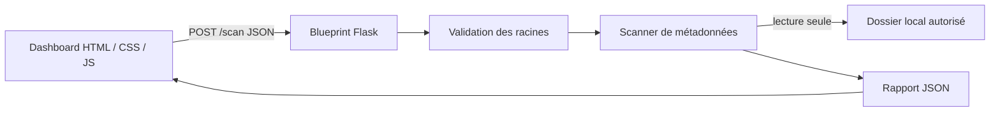

# Architecture SmartFiles

## Version livrée

`app.py` expose l'application. `smartfiles.create_app()` charge la configuration et assemble
les routes ; la fabrique permet d'injecter une racine temporaire dans chaque test.
`routes.py` traduit HTTP en appels métier. `safety.py` valide les chemins absolus résolus,
refuse liens et jonctions et vérifie l'appartenance avec `Path.is_relative_to`, sans comparaison
naïve de préfixes. `scanner.py` parcourt les fichiers et produit un rapport sérialisable.
Les templates et ressources statiques appartiennent au package web.

## Données et limites

Aucune base de données à ce stade. Le rapport n'est gardé que dans la page et la requête.
Taille et dates viennent du système ; aucune date de création n'est inventée à partir de ctime.
La date d'accès dépend de la politique du système et ne prouve pas qu'un fichier a été lu.
Les chemins de fichiers sont relatifs au dossier analysé dans la réponse ; la racine reste absolue.
Les catégories sont déduites des extensions, pas du contenu.
Le scanner est synchrone et conserve au plus MAX_FILES résultats. Il peut donc bloquer sur un
stockage lent ; pagination, budget temporel et tâche asynchrone restent à ajouter.
Les erreurs d'accès sont signalées (100 avertissements maximum) ; le résultat peut être incomplet.

## Sécurité locale

Écoute sur loopback par défaut, aucune action d'écriture et aucun appel IA.
Les noms sont affichés avec `textContent`, jamais comme HTML provenant du disque.
Les requêtes invalides ont des erreurs JSON ; aucun CORS n'est activé.
Le service n'a pas d'authentification : toute personne ayant accès au service peut consulter
les racines et les métadonnées autorisées. Ne pas le publier.
La validation et le parcours ne sont pas atomiques : un processus local hostile pourrait remplacer
un fichier par un lien pendant le scan (TOCTOU). Utiliser un dossier de confiance stable ;
le montage Docker en lecture seule limite les écritures depuis le conteneur, pas depuis l'hôte.

## Architecture cible

La phase 2 ajoutera un routeur Groq/Ollama et des recommandations en streaming. Les fournisseurs
seront interchangeables et le contexte sera limité aux métadonnées après consentement cloud.
Le modèle ne disposera d'aucun accès direct aux opérations disque.
La phase 3 ajoutera des plans validés côté serveur, expirables et liés à un instantané du scan :
prévisualisation → confirmation explicite → revalidation → exécution → journal durable.
Suppression vers une corbeille privée, jamais définitive par défaut ; collisions refusées,
extensions protégées et annulation testée avant d'activer les actions.

## Décisions

- Flask + JavaScript natif : suit le TP et réduit les composants à déployer.
- Package `smartfiles/` plutôt que modules génériques `src/` : imports explicites et fabrique testable.
- Python >=3.11 : compatible avec l'installation locale ; 3.12 recommandé. Les dépendances non
  utilisées (SDK IA, Pillow) seront ajoutées avec leurs fonctionnalités.
- CSS local : aucun CDN requis pour la démo, pas de dépendance réseau au chargement.
- uv + lock : un environnement partagé entre développement et CI ; Docker exclut les outils dev.
